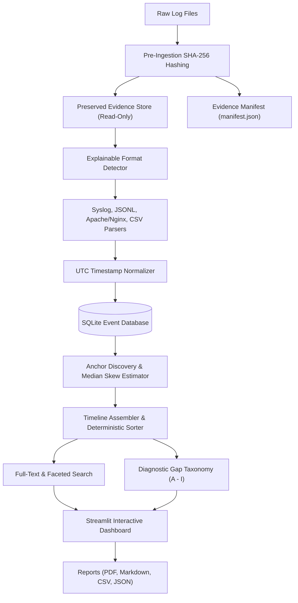

# Chronica: Digital Forensics Incident Timeline & Evidence Collection Tool

**AIORI-3 Cybersecurity Problem Statement PS-013: Incident Timeline and Evidence Collection for Small Teams**

[]()
[]()
[]()
[]()

---

## 1. Problem Statement & Real-World Mission

Small IT teams and solo incident responders often face severe challenges during cyber intrusions. When investigating an active incident across Linux servers, web gateways, backend applications, and firewalls, evidence is fragmented across logs with:
- Drifting and desynchronized host clocks.
- Inconsistent and mixed time zones (UTC, EDT, IST, local naive).
- Yearless BSD syslog timestamps.
- Corrupted, truncated, or dropped lines.
- Quiet intervals that may look like log clearing.
- Disconnected event identifiers.

**Chronica** is a lightweight, offline-first digital forensics utility that ingests multi-source logs, preserves pristine raw evidence with cryptographic SHA-256 digests, normalizes timestamps to UTC, correlates events across systems, estimates clock offsets using robust median statistics, flags evidence gaps, and produces publication-ready incident reports in PDF, Markdown, CSV, and JSON.

### Foundational Forensic Principle
> **Treat evidence bytes, parsed fields, timing normalizations, clock-skew corrections, and conclusions as distinct entities.**
> Chronica never overwrites original logs, never turns an estimate into a fact, and never guesses unrecorded data silently.

---

## 2. Key Capabilities & Implemented Features

| Module | Forensic Feature | Implementation Details |
|---|---|---|
| **Evidence Ingestion** | Multi-file preservation | Read-only local storage, path traversal protection (`../`), configurable size limit (100MB). |
| **Integrity Engine** | Cryptographic verification | Pre-ingestion SHA-256 streaming hashing (64KB chunks), structured JSON manifest, 1-click re-verification audit. |
| **Log Parsers** | Multi-format support | RFC 3164 BSD & RFC 5424 Syslog (sshd, sudo), JSON Lines (JSONL), Apache/Nginx (CLF/Combined), CSV Firewall. |
| **Format Detection** | Explainable autodetection | Transparent heuristic scoring sample lines against parser signatures with confidence scores. |
| **Normalization** | Robust UTC conversion | Microsecond precision, explicit offset conversion, yearless BSD syslog inference tracking (`year_inferred=True`). |
| **Clock-Skew Engine** | Offset estimation | Shared anchor discovery (`request_id`, `session_id`), robust median statistics, MAD spread measurement, inconclusive marking for $< 2$ anchors. |
| **Timeline Explorer** | Multi-axis chronology | Sorting by Normalized UTC, Corrected UTC, or Original sequence; deterministic tie-breaking on `(evidence_id, line_number)`. |
| **Search & Filtering** | Conjunctive faceted search | Full-text keyword querying + combined filters by Host, User, IP, Severity, Category, Time range. |
| **Diagnostics & Gaps** | 9-category taxonomy | Quantifies quiet period gaps (Category F), parse failures (Category A), integrity mismatches (Category H). Explicit denominators. |
| **Export Engine** | Publication-grade reports | Downloadable ReportLab PDF, complete 17-section Markdown report, RFC 4180 CSV, structured JSON. |
| **Synthetic Suite** | 3 reproducible scenarios | Scenario 1 Clean Baseline, Scenario 2 Clock Skew (+180s), Scenario 3 Degraded Evidence; answer keys stored separately. |

---

## 3. Architecture & Data Flow



---

## 4. Requirements & Installation

Chronica runs completely offline on standard hardware without external cloud APIs, SIEM subscriptions, or administrative privileges.

### System Requirements
- Python 3.11, 3.12, 3.13, or 3.14
- Operating System: Windows, Linux, or macOS

### Installation Steps

1. Clone or navigate to the repository directory:
   ```bash
   cd chronica
   ```

2. Install dependencies:
   ```bash
   pip install -r requirements.txt
   ```

---

## 5. Launch & Usage Guide

### Launching the Application
Run the following command from the repository root:

```bash
streamlit run app.py
```

Open your web browser at **`http://localhost:8501`**.

---

### Step-by-Step Investigator Workflows

#### 1. Create an Investigation
- Open **📂 Case Management** in the sidebar.
- Enter a unique **Case ID** (e.g., `case_2026_q3_triage`) and **Investigation Title**.
- Select the baseline case timezone (e.g. `UTC`). Click **Create Case Workspace**.

#### 2. Import & Preserve Evidence Files
- Navigate to **📁 Evidence Ingestion**.
- Upload one or more log files (Syslog, JSONL, Apache/Nginx, CSV).
- Select **Auto-Detect Format (Explainable)** or choose an explicit parser.
- Click **🚀 Ingest, Hash & Parse Evidence**.
- Chronica hashes files with SHA-256 before parsing and saves a pristine read-only copy in the investigation directory.

#### 3. Verify Cryptographic SHA-256 Integrity
- Navigate to **🔒 Evidence Integrity (SHA-256)**.
- Review recorded digests in the manifest.
- Click **🔄 Verify All Evidence Now**.
- Chronica re-hashes every on-disk file, displaying green `✅ VERIFIED` or red `❌ MISMATCH` badges.

#### 4. Explore the Chronological Timeline
- Navigate to **⏱️ Timeline Explorer**.
- Toggle sorting:
  - **Normalized UTC**: Standard UTC chronological order.
  - **Clock-Corrected UTC**: Synchronized order with host clock offsets subtracted.
  - **Original Line Sequence**: Pristine acquisition order.
- Select any event in the **Event Detail Inspector** to inspect raw lines, parsed fields, normalization flags, and source provenance.

#### 5. Search & Filter
- Navigate to **🔍 Search & Filter**.
- Enter keyword queries or filter by Host, User, IP, Severity, and Category.
- Filter criteria operate conjunctively (AND logic) on actual event data.

#### 6. Inspect Clock-Skew Offsets
- Navigate to **⏳ Clock-Skew Analysis**.
- Chronica uses the documented sign convention:
  $$\text{offset} = \text{target\_clock} - \text{reference\_clock}$$
  $$\text{corrected\_time} = \text{target\_time} - \text{offset}$$
- Inspect the anchor table linking events by shared `request_id` or `session_id`.
- Chronica requires $\ge 2$ confirmed anchors; single anchors are marked `INCONCLUSIVE_INSUFFICIENT_ANCHORS`.

#### 7. Inspect Gaps & Diagnostics
- Navigate to **⚠️ Gaps & Diagnostics**.
- Inspect coverage rates (with explicit denominators).
- Review findings across taxonomy categories A through I (corrupted lines, quiet period gaps, unrecorded years).

#### 8. Export Investigation Reports
- Navigate to **📑 Reports & Export**.
- Download:
  - **PDF Report**: Publication-grade PDF with tables, metrics, and disclaimers.
  - **Markdown Report**: 17-section incident report conforming to hackathon standards.
  - **CSV Timeline**: Standard forensic spreadsheet.
  - **JSON Case**: Machine-readable case backup.

---

## 6. Running the Automated Test Suite

Chronica features a 3-tier automated test suite covering unit, integration, and end-to-end functionality:

```bash
python -m pytest -v
```

### Verified Test Summary:
```text
tests/end_to_end/test_scenarios_e2e.py::test_scenario_1_e2e PASSED
tests/end_to_end/test_scenarios_e2e.py::test_scenario_2_e2e_clock_skew PASSED
tests/end_to_end/test_scenarios_e2e.py::test_scenario_3_e2e_degraded_evidence PASSED
tests/integration/test_investigation_lifecycle.py::test_investigation_lifecycle_isolation PASSED
tests/integration/test_tamper_detection.py::test_tamper_detection_triggers_diagnostic_alert PASSED
tests/unit/test_clock_skew.py (6 tests) PASSED
tests/unit/test_diagnostics.py (2 tests) PASSED
tests/unit/test_exports.py (4 tests) PASSED
tests/unit/test_hashing_and_manifest.py (8 tests) PASSED
tests/unit/test_normalization.py (7 tests) PASSED
tests/unit/test_parsers.py (8 tests) PASSED
tests/unit/test_search_and_filter.py (5 tests) PASSED

============================= 46 passed in 0.57s ==============================
```

---

## 7. Generating & Benchmarking Synthetic Scenarios

Chronica provides three reproducible synthetic scenarios:
- **Scenario 1 (Clean Baseline):** Nginx web log, Linux auth.log, and JSONL app log with pristine timestamps.
- **Scenario 2 (Clock Skew & TZ Mismatch):** Host B has a known $+180.0\text{s}$ clock skew and EDT ($-04:00$) timezone; correlated anchors restore true physical sequence.
- **Scenario 3 (Degraded Evidence):** Malformed JSON, corrupted timestamp, missing user/IP fields, 45-minute coverage gap, duplicate candidate, and inconclusive skew.

### Generate / Reset Scenarios via CLI:
```bash
python scripts/generate_scenarios.py
```

### Run Quantitative Benchmark Suite:
```bash
python scripts/run_evaluation.py
```

### Benchmark Results Overview:
- **Scenario 2 Offset Error:** **0.00s** ($+180.00\text{s}$ ground truth vs $+180.00\text{s}$ estimated).
- **Post-Correction Timing Residual:** **0.00s** (exact synchronization recovery).
- **Kendall's Tau Concordance:** $0.926 - 0.989$.
- **Scenario 3 Robustness:** $100\%$ graceful handling of malformed records; 18 distinct diagnostic findings identified.

---

## 8. Forensic Disclaimers & Legal Notice

1. **Research Prototype:** Chronica is designed for small IT teams, defenders, and educational research. Findings must be corroborated before formal judicial submission.
2. **Hash Guarantee:** A matching SHA-256 hash certifies that the file has not been modified since collection. It does not certify that logs were genuine when originally created.
3. **Quiet Periods:** Logging quiet intervals represent lack of records, not proof of malicious log clearing.
