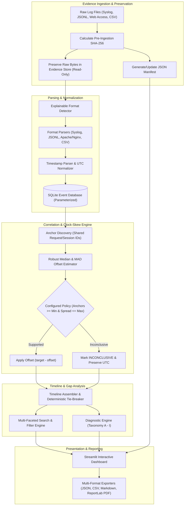

# Chronica System Architecture & Design Specification

**AIORI-3 PS-013: Incident Timeline and Evidence Collection for Small Teams**

---

## 1. Executive Architectural Summary

Chronica is an offline-first digital forensics timeline reconstruction and evidence management application designed for incident response teams, small IT departments, and security researchers.

### Core Forensic Principle
> **Treat evidence bytes, extracted fields, timing normalizations, clock-skew estimates, and conclusions as distinct entities.**
> Chronica never overwrites original logs, never silently guesses missing data without documenting inferences, and never presents estimated clock offsets as certified hardware clock facts.

---

## 2. Architecture & Data Flow

---

## 3. Subsystem Breakdown

### 3.1 Evidence Preservation (`src/evidence/`)
- **`hashing.py`**: Computes SHA-256 cryptographic digests in 64 KB streaming chunks to prevent memory exhaustion on large files.
- **`collector.py`**: Sanitizes input filenames against directory traversal (`../`, null bytes, illegal shell characters), enforces configurable file limits (100 MB), and applies read-only attributes.
- **`manifest.py`**: Maintains `manifest.json` tracking evidence IDs, filenames, sizes, collection timestamps, and composite digest.
- **`verification.py`**: Re-reads and re-hashes on-disk files, comparing them against the manifest to immediately flag `VERIFIED`, `MISMATCH`, or `UNAVAILABLE`.

### 3.2 Parser Engine (`src/parsers/`)
- **`syslog_parser.py`**: Parses RFC 3164 BSD and RFC 5424 syslog, extracting SSH accepted/failed logins, invalid users, and sudo privilege escalation commands.
- **`jsonl_parser.py`**: Ingests newline-delimited JSON application logs, mapping standard synonyms (`time`, `timestamp`, `level`, `req_id`) while isolating unmapped attributes into `extra_fields`.
- **`web_access_parser.py`**: Parses Apache/Nginx Common Log Format (CLF) and Combined Log Format, capturing client IP, HTTP method, URI, status codes, user agents, and request IDs.
- **`csv_firewall_parser.py`**: Ingests packet filter logs (timestamp, src_ip, dst_ip, proto, action, rule_id).
- **`detector.py`**: Explainable autodetection assessing sample lines against regex signatures with transparent confidence scores.

### 3.3 Timeline & Normalization (`src/timeline/`)
- **`schema.py`**: Canonical `Event` model capturing 28 distinct forensic fields including raw text, parsed time, normalized UTC, corrected UTC, normalization status, and provenance.
- **`normalization.py`**: Normalizes ISO 8601, CLF, BSD Syslog, and epoch formats to UTC with microsecond precision, explicitly tracking inferred years and assumed timezones.
- **`clock_skew.py`**: Implements defensible clock-skew estimation:
  $$\text{offset} = \text{target\_clock} - \text{reference\_clock}$$
  $$\text{corrected\_time} = \text{target\_time} - \text{offset}$$
  Estimates offset using the median of confirmed anchor pairs and measures spread using Median Absolute Deviation (MAD). Requires $\ge 2$ independent anchors; otherwise labels the relationship `INCONCLUSIVE`.
- **`assembler.py`**: Merges events into a unified timeline with deterministic secondary tie-breaking on `(evidence_id, line_number, event_id)`.
- **`search.py`**: Full-text keyword search and multi-attribute conjunctive filtering.

### 3.4 Diagnostics & Gaps (`src/diagnostics/`)
Implements the 9-category forensic taxonomy:
- **`A_PARSE_FAILURE`**: Corrupted record structure.
- **`B_UNSUPPORTED_RECORD`**: Unrecognized log format.
- **`C_TIMESTAMP_FAILURE`**: Missing or impossible date/time.
- **`D_TIMESTAMP_AMBIGUITY`**: Relies on inferred year, timezone assumption, or DST transition.
- **`E_MISSING_FIELD_WARNING`**: Auth or request log missing user or IP.
- **`F_COVERAGE_GAP`**: Silence interval exceeding threshold (default 30 min). Documents that quiet periods do not prove malicious log clearing.
- **`G_UNRESOLVED_CLOCK_SKEW`**: Insufficient or conflicting anchor observations.
- **`H_EVIDENCE_INTEGRITY_ISSUE`**: SHA-256 mismatch or missing file.
- **`I_DUPLICATE_CANDIDATE`**: Redundant log lines detected across files.

### 3.5 Storage & Repositories (`src/storage/`)
- **`database.py`**: Parameterized SQLite store (`data/chronica.db`) with indexes on normalized time, request ID, host, user, and IP.
- **`repository.py`**: Investigation workspace manager isolating cases in `data/investigations/<case_id>/`.
